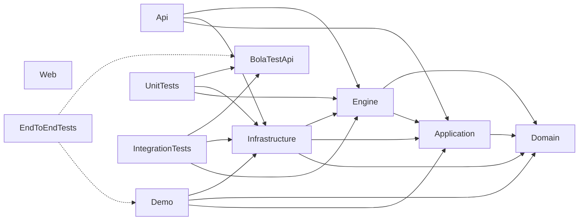

# Revizija arhitekture i kvaliteta BOLA Detector-a

Faza 5.2 dokumentuje opcioni port oporavka, granicu lokalnog API-ja i
zajednički rok oporavka i čišćenja.
[Pouzdano kreiranje i čišćenje](implementation-v5-2-reliable-creation-and-cleanup.md).

Revizija od 25. novembra 2026. obuhvata commit `80768b7`, postojeće radne
izmjene i centralizovanu validaciju iz trećeg inkrementa. Kriterijumi su
preuzeti iz zadatka. Numerisane prezentacije 1–13
nisu pronađene u repozitoriju, dostupnim prilozima ili pregledanim materijalima
na Desktopu. [Matrica usklađenosti](architecture-compliance-checklist.md)
zato daje dokaz iz koda i testova bez navođenja stranica prezentacija.

## Projekti i pravilo zavisnosti

| Projekat | Odgovornost i nalaz |
| --- | --- |
| Domain | Model pristupa, resursa, pripremljenih dokaza i klasifikacije. Bez projektnih, NuGet i framework referenci ili zavisnosti od JSON parsera. |
| Application | `RunDetection`, portovi, semantička validacija konfiguracije i rezultati. Projektno zavisi od Domain-a. |
| Engine | Implementira portove za generisanje scenarija i njihovu orkestraciju. `AuthorizationOracle` delegira domensku odluku `AccessRule`. |
| Infrastructure | Adapteri za HTTP, dokaze, konfiguraciju i izvještaje, OpenAPI i EF. Odvojeni folderi odgovornosti. Referenca na Engine služi DI registraciji. |
| Api | Registruje Identity, EF i adaptere, izlaže health, auth i zaštićeno čitanje projekata. Detekcioni slučaj korišćenja pokreće Demo. |
| Demo | Učitava ulaz, sastavlja detektor, mapira izlazni kod i prikazuje izvještaj. |
| Web | Statička React/TypeScript početna stranica. Zaseban npm projekat. |
| BolaTestApi | Sintetički identiteti i dokumenti. Početni podaci Read demonstracije odvojeni su od lokalnog CRUD-a. |
| UnitTests | Model pristupa, generator, analiza, portovi, HTTP adapter sa stubom, store i arhitektonske granice. |
| IntegrationTests | Stvarni ASP.NET pipeline preko TestServer-a i fajl izvještaja. |
| EndToEndTests | Procesni NUnit testovi koji pokreću Demo i lokalni API preko zasebnih .NET procesa. |

Dijagram prikazuje direktne `ProjectReference` nakon revizije. Svaki
link polazi od izvornog projekta prema njegovoj zavisnosti. Isprekidane
E2E veze određuju samo redoslijed builda. Web nema .NET referencu.



Graf je ponovo provjeren prema svim `.csproj` datotekama i binarnim
referencama jezgra. Acikličan je i ostao je isti tokom ove revizije.
U izvršavanju `RunDetection` poziva `IDetectionEngine`,
a implementacija poziva aplikacione portove čije adaptere bira composition
root. Seed dokumenti pripadaju isključivo testnom API-ju. `ApiOperation` i
status odgovora legitimni su podaci o problemu koji detektor analizira.
JSON prikaz snimka obrađuje infrastrukturni adapter. Domain prima ishode
poređenja.
Engine kao odvojeni projekat ima opravdanje jer sadrži politiku izvršavanja
bez mreže i baze. Odvajanje Persistence u novi projekat trenutno bi dodalo
referencu bez promjene postojeće granice.

## SOLID i čitljivost

| Princip | Procjena u stvarnom kodu |
| --- | --- |
| SRP | `DetectionEngine.ExecuteAsync` koordinira jedan scenario. `RunDetection.ExecuteAsync` validira ulaz i koordinira sesiju. `BolaScenarioGenerator` delegira validaciju i gradi kombinacije; `AuthorizationOracle.IsAllowed` delegira domensko pravilo. `FindingAnalyzer` spaja klasifikaciju i tehničko parsiranje snimaka. `HttpScenarioRequestExecutor` ima jednu transportnu ulogu uz široku klasifikaciju izuzetaka. `JsonReadEvidenceVerifier`, `JsonDetectionReportWriter` i `OpenApiImporter` su fokusirani adapteri. `TestDocumentStore` čuva stanje i vodi atomske mutacije. `DocumentEndpoints` povezuje demo rute i CRUD, a `DocumentCrudEndpoints` mapira CRUD i lokalnu granicu pristupa. |
| OCP | Novi adapteri konfiguracije, izvještaja, dokaza i čitanja projekata mogu implementirati odgovarajuće portove. Novi tip scenarija bi dodirnuo generator i izvršilac zbog eksplicitnog GET ugovora. Trenutne grane klasifikacije predstavljaju politiku, pa ih nema potrebe pretvarati u hijerarhiju. |
| LSP | Testni transport, sat i generator zamjenjuju konkretne implementacije prema portovima. Ugovor transporta dokumentuje podržano čitanje, opažanje greške i propagiranje otkazivanja. `IDetectionEngine` ranije nije opisivao isti preduslov; dodat je opis. `RunDetection` očekuje rezultat koji tip `TestExecution` dopušta izostaviti. |
| ISP | Jednonamjenski portovi za čitanje projekata, izvještavanje, import i verifikaciju odgovaraju potrošačima. Širenje na generičke repozitorijume ili interfejse za jednostavne vrijednosti uvelo bi dodatne ugovore. |
| DIP | Unutrašnji slojevi definišu portove. Konstruktorima se ubrizgavaju transport, dokazi i sat. Poziv `GetRequiredService` pripada Demo composition root-u. Singleton adapteri su uglavnom bez stanja; store koristi zaključavanje, a dijeljena konfiguracija izlaže kolekcije za izmjenu. EF kontekst i čitač su scoped, izvršilac i use case transient. |

Imena i namespace-i uglavnom prate C# konvencije. Folderi grupišu
odgovornosti bez promjene javnih namespace-a. Nazivi `ObservedResponse`,
`ResponseObservation` i `ScenarioResult` označavaju tri različite granice.
Prvi nosi prolazno tijelo, drugi tehnički sažetak, a treći javni rezultat.
Miješani stil naziva testova i nečitljivi dijakritički znakovi u Web šablonu
ostali su kao manji dug. Izostanak globalnih suppressions, upotreba
`using` za HTTP odgovor i JSON dokument, propagiranje otkazivanja i
ponovna upotreba upravljanog HTTP klijenta su zadržani.

## Nalazi, ozbiljnost i regresioni rizik

| Lokacija i princip | Ozbiljnost i konkretan problem | Rješenje, rizik i provjera |
| --- | --- | --- |
| `BolaDetector.Demo.csproj`, `DetectionConsoleApplication`, pravilo zavisnosti | Niska. Demo direktno koristi Application i Domain tipove preko tranzitivnih referenci. | Direktno deklarisane obje unutrašnje reference. Rizik je ograničen na graf kompajliranja. Arhitektonski test i build. |
| `DependencyRulesTests.ProductionProjectReferencesPointTowardTheCore`, izolacija | Srednja. Pravila ranije nisu pokrivala reference samog `BolaTestApi` projekta. Provjera po imenu mogla je previdjeti putanju do drugog projekta istog imena. | Uključena izolacija ciljnog projekta i poređenje normalizovanih putanja. Binarna provjera eksplicitno navodi dozvoljene interne reference. Rizik je vezan za legitimno premještanje projekta; takva izmjena zahtijeva ažuriranje pravila. |
| `IDetectionEngine.ExecuteAsync`, `RunDetection.ExecuteAsync`, LSP i invarijanta | Srednja. Preduslov scenarija ranije je bio vidljiv tek u implementaciji. Izostavljen rezultat dozvoljen modelom dovodi do izuzetka use case-a. | Dokumentovan trenutni ugovor. Promjena obaveznog rezultata ili uvođenje posebnog tipa izvršenog scenarija traži pregled javnog ugovora. Provjeriti portove i prijevremeni prekid. |
| `DocumentCrudEndpoints.MapDocumentCrudEndpoints`, SRP i DRY | Niska. Lokalni identitet bio je provjeravan unutar metode za mapiranje ruta. Ograničenje naslova postoji i u validaciji i u poruci. | Izdvojena metoda filtera, granica naslova je imenovana konstanta. Isti redoslijed provjera i statusi. Unit i TestServer CRUD regresija. |
| `FindingAnalyzer.Analyze` i `AnalyzeRecordedWrite`, SRP i jedinstvenost politike | Srednja u referentnom stanju. Stariji ugovor poredi tekst, dok noviji traži semantički potvrđenu namjeravanu izmjenu. | JSON obrada je izdvojena. Očuvani kriterijumi i migracija su dokumentovani u [pripremi dokaza](#priprema-dokaza-i-domenska-klasifikacija). |
| `DetectionConfiguration`, `JsonDetectionConfigurationLoader.LoadAsync`, validacija i enkapsulacija | Srednja. U referentnom stanju eksplicitne null kolekcije i neispravne reference mogle su izazvati kasni kvar. | Centralizovana provjera uvedena je na aplikacionoj granici i pokrivena validacionim testovima. Javne konfiguracione liste ostaju promjenljive radi postojećih pozivalaca. [Detalji validacije](implementation-v3-configuration-validation.md). |
| `ApiProject`, `ProjectEndpoints.MapProjectEndpoints`, enkapsulacija i mapiranje | Srednja. Projekat ima javno promjenljiv identitet, a ruta vraća EF-mapirani domenski model i cijeli OpenAPI dokument. | Predložiti invarijante i izlazni DTO uz pregled API ugovora i EF mapiranja. Rizik je promjena JSON oblika ili učitavanja baze. Test ugovora i EF integracija. |
| `HttpScenarioRequestExecutor.SendAsync`, obrada grešaka | Srednja. Široki `ArgumentException` i `InvalidOperationException` mogu pripisati kvar HTTP komponente kredencijalima. | Suziti granicu hvatanja nakon odobrenja očekivanih rezultata. Testirati grešku provajdera, grešku transporta, timeout i eksplicitno otkazivanje. |
| `JsonReadEvidenceVerifier.Project` i `Verify`, semantika i trošak | Srednja. Ugniježđene JSON vrijednosti porede se tekstualno, a isti skup polja sortira se za svaku projekciju. | Prvo definisati ugovor semantičkog poređenja i validacije duplikata. Rizik je promjena klasifikacije i SHA-256 otiska. Optimizaciju sortiranja vezati za provjereno nepromjenljivu konfiguraciju, uz mjerenje. |
| `OpenApiImporter.Parse`, validacija i testabilnost | Srednja. Postoje parser i dijagnostika, ali nema namjenskih testova prazne, neispravne i validne specifikacije. | Dodati testove postojećeg parsera prije proširenja ugovora. Koristiti sintetičke specifikacije bez mreže. |
| `JsonDetectionReportWriter.WriteAsync`, pouzdanost | Niska. Direktan upis može ostaviti djelimičan fajl pri prekidu; `GetDirectoryName(...)!` pretpostavlja putanju fajla. | Razmotriti privremeni fajl i zamjenu ako potrošač zahtijeva atomsku objavu. Rizik su dozvole i ponašanje kod postojećeg fajla. Testirati prekid i postojeći izvještaj. |
| `BolaScenarioGenerator.Generate`, performanse | Niska. Pretražuje vlasnika i pravila unutar petlji. Nema izmjerenog uskog grla na lokalnom opsegu. | Indeksiranje tek uz dokaz troška. Provjeriti ponašanje duplih i nedostajućih pravila. |
| `BolaDetector.zip`, `bola-report.json`, Git | Niska. Praćen je arhiv i dodatni izvještaj pored dokumentovanog demo primjera. Arhiv može duplicirati izvor ili zastarjeti. | Pregledati porijeklo i dogovoriti šta je namjerno sačuvano prije uklanjanja. Git diff i README linkovi. |

Veći zahvati iz tabele ostaju prijedlozi za odobrenje. Lokalizovane izmjene
zadržavaju javne ponašajne ugovore, istoriju i sigurnosna ograničenja.

## OOP, DDD i komande/upiti

Glavni domen je modelovanje i provjera autorizacije nad resursom. `AccessRule`
je model ponašanja, a `AuthorizationOracle` njegov adapter prema aplikacionom
portu. Scenariji i izvršavanja pripadaju toku provjere. Nalazi i dokaz
predstavljaju rezultat analize. Izvještaji su izlazni modeli. Administracija
projekata i korisničkih naloga je pomoćni kontekst. Sintetički dokumenti
i `X-Test-User` pripadaju zasebnom ograničenom kontekstu testnog API-ja.

`TestIdentity`, `Organization`, `TestResource`, `ApiProject`,
`TestScenario` i `VulnerabilityFinding` imaju identitet. Record tipovi imaju
strukturnu jednakost, dok pravilo autorizacije provjerava konkretne ID-eve.
`AccessRule`, `ReadEvidence` i snimak su vrijednosno orijentisani. Record i
`init` štite dodjelu svojstva, ali ne čine sadržanu listu nepromjenljivom.
Ponašanje imaju relevantne politike, dok su konfiguracija i izvještaji
strukture za razmjenu. Opravdano je zadržati kompoziciju portova i nekoliko
plosnatih hijerarhija, uključujući EF Identity kontekst i testne hostove.
Posebni tipovi ID-eva vrijede ako stvarno sprečavaju zamjenu vlasnika i
organizacije. Nema utvrđene potrebe za transakcionim domenskim agregatom
preko više entiteta ili za pretplatom na domenske događaje.

`IApiProjectReader` je uski query port, a `EfApiProjectReader` ga
implementira sa `AsNoTracking` i bez izlaganja `IQueryable` ili EF tipova.
`FindCreated` je upit, `Update` i `Delete` su komande. `Create` vraća
kreirani dokument i ID kao korisni ishod iste mutacije. `RunDetection`
izvršava provjeru i sastavlja rezultat u memoriji. Demo zasebno piše
izvještaj. Ove odgovornosti mogu se razdvajati bez posebnog CQRS spremišta.

## Projektni obrasci

| Obrazac | Primjena, korist i granica |
| --- | --- |
| Singleton | DI životni vijek nekih adaptera i store-a. Store zaključava mutacije. GoF globalna instanca bi otežala izolaciju. |
| Factory Method | `IHttpClientFactory` i delegat za primarni handler rješavaju kreiranje transporta kroz framework. U kodu aplikacije nema GoF hijerarhije factory metoda. |
| Abstract Factory | Nema porodica zavisnih proizvoda. DI registracije pokrivaju izbor adaptera. |
| Builder | `WebApplication.CreateBuilder` je framework builder. Složenost domenskih objekata zasad ne opravdava poseban builder. |
| Prototype | `with` kopira record pri izmjeni testnog dokumenta. Nema polimorfnog registra prototipa, a plitko kopiranje odgovara njegovim string vrijednostima. |
| Adapter | HTTP, EF, JSON i OpenAPI adapteri prevode tehničke zavisnosti na unutrašnje portove. Prednost je izolacija, a cijena je održavanje mapiranja i ugovora. |
| Bridge | Nema dvije hijerarhije koje se mijenjaju nezavisno. Odvajanje porta i adaptera pokriva postojeću potrebu. |
| Decorator | HTTP pipeline omogućava dekoraciju handlerima. Nema aplikacionog dekoratora s izmjenom ponašanja istog porta. |
| Composite | Lista koraka nema rekurzivnu strukturu i zajednički ugovor lista/grana. |
| Facade | `RunDetection` ima funkciju fasade prema CLI-u jer skriva orkestraciju generatora i izvršioca. Naglasak je na aplikacionom slučaju korišćenja. |
| Template Method | Nema bazne klase sa skeletom algoritma i override koracima. Kompozicija ovdje bolje izoluje saradnike. |
| Strategy | `IReadEvidenceVerifier` i transportni port omogućavaju zamjenu ponašanja; alternativne implementacije su dokazane u testovima. Dodatna produkciona strategija bi tražila stvarnu potrebu. |
| Command | CRUD metode mijenjaju stanje, ali nema objekta komande s nezavisnim izvršavanjem/raspoređivanjem. |
| Memento | `ResourceSnapshot` predstavlja dokaz. Obnova stanja objekta iz njega nije implementirana. |
| Chain of Responsibility | ASP.NET middleware i endpoint filter imaju lanac odgovornosti. Lokalni filter može prekinuti obradu ili pozvati sljedeću kariku. |
| Observer | `Console.CancelKeyPress` koristi framework događaj za otkazivanje. Nema domenskih pretplatnika i razloga za event bus. |
| State | `ExecutionStatus` je vrijednost. Nema objekata stanja s različitim ponašanjem. |
| Iterator | `foreach` i LINQ koriste standardne kolekcijske iteratore. Poseban iterator ne bi pojednostavio tok. |
| Visitor | Model nema hijerarhiju elemenata koja zahtijeva otvoren skup operacija nad stabilnim tipovima. |

## Testabilnost i proces razvoja

Port testovi koriste fiksni `TimeProvider`, generator jednog scenarija i
memorijski transport. HTTP jedinični testovi koriste determinističke
odgovore ili transportnu grešku. Integracija koristi stvarne implementacije
relevantnih komponenti sa TestServer-om. Ovo pokriva DI, autorizaciju, stvarni
CRUD pipeline i izvještavanje. ID-evi koriste `Guid.NewGuid()`; testovi
provjeravaju jedinstvenost i oblik vrijednosti. Vrijeme nije globalno
za detekciju. Pokrivanje ponašanja je važnije od broja scenarija.
Procesni E2E za dozvoljeni CRUD može pokrenuti Kestrel na slobodnom loopback
portu i ukloniti resurs i proces u `finally`. Ovo je zaseban backlog zadatak.

Projekt koristi .NET 8, nullable analizu u `Directory.Build.props` i
standardne SDK analizatore. Nema repozitorijskog `.editorconfig` ni
posebnih analyzer paketa. `.gitignore` pokriva bin, obj, node_modules,
lokalne konfiguracije i `.env`. Praćen je `.env.example` s lokalnim
primjerima, uz dokumentovani demo izvještaj. U pregledanim konfiguracijama
identiteti detektora koriste `env:` reference. Pregled verzionisanih
konfiguracija ne predstavlja potpunu pretragu tajni u arhivu i svim
istorijskim objektima. Dva postojeća commita označavaju Read i CRUD
inkremente. Radno stablo bilo je čisto na početku.

Backlog po prioritetu:

1. Centralizovana validacija konfiguracije završena je u trećem inkrementu.
   Ostaje procjena potrebe za nepromjenljivim listama kod budućih paralelnih
   scenarija.
2. Ugovoriti razdvajanje JSON snimka od politike i očuvati klasifikaciju
   kroz postojeće i dodatne granične testove.
3. Dodati ciljane testove OpenAPI parsera i procesni E2E za autorizovani
   lokalni CRUD. Evidentirati pokretanje i čišćenje procesa.
4. Pregledati API DTO i EF invarijante prije izmjene ugovora. Evidentirati
   istorijske izvještaje i arhiv koji se čuvaju namjerno.

[Pravila budućih inkremenata i Definition of Done](architecture-rules.md).

## Stvarne provjere prije i poslije

Sljedeći blok opisuje prethodnu reviziju. Rezultati tekuće revizije i
promjene nad trećim inkrementom navedeni su niže.

| Provjera | Referentno stanje | Završno stanje |
| --- | --- | --- |
| .NET Release build | 0 grešaka, 0 upozorenja | 0 grešaka, 0 upozorenja |
| NUnit jedinični | 47 od 47 | 49 od 49, uključujući dva testa OpenAPI parsera |
| NUnit integracioni | 9 od 9 | 9 od 9 |
| NUnit EndToEnd | Bez testova | Bez testova |
| Read regresija preko TestServer-a | 8 scenarija, 6 bez uočenog kršenja, 2 potvrđena | Isti rezultati |
| Autorizovani CRUD preko loopback mreže | POST 201, GET 200, PUT 204, DELETE 204 | Isti statusi i provjeren izmijenjeni naslov. Korišćen zaseban Release proces na portu 5082. |
| `dotnet format --verify-no-changes` | Izlazni kod 0 | Izlazni kod 0 |

Debug build je naišao na zaključan `BolaTestApi.exe` od postojećeg
lokalnog procesa. Release je omogućio kompajliranje i verifikaciju bez
prekidanja tog procesa. Za restore korišćeni su lokalno dostupni paketi i
komandna opcija `NuGetAudit=false`. Procjena ranjivosti paketa zato nije
dio ovih rezultata. Komande završne provjere:

```powershell
dotnet build BolaDetector.sln -c Release -m:1 -p:NuGetAudit=false --ignore-failed-sources
dotnet test BolaDetector.sln -c Release --no-build --no-restore -m:1
dotnet format BolaDetector.sln --verify-no-changes --no-restore --verbosity minimal
docker compose config --quiet
```

Ponašanje Read demonstracije potvrđeno je integracionom provjerom.
Zaseban Read CLI proces nije pokrenut tokom revizije. Provjeren je
`docker compose config --quiet`, ali Docker daemon nije odgovorio na
`docker compose ps`, pa MySQL i Identity nisu verifikovani u kontejnerima.
TypeScript korak prošao je u `npm run build`, a Vite je prekinuo
pakovanje pri kreiranju podprocesa uz `spawn EPERM`.

Pokušaj mjerenja `dotnet test --collect 'Code Coverage'` prekinut je
nakon što je kolektor ostao bez rezultata. Procente pokrivenosti nije moguće
navesti. U trenutku revizije uočene su praznine u validaciji null vrijednosti,
stvarnoj MySQL/Identity integraciji i automatizovanom procesnom E2E testu.
Prva praznina je obrađena u trećem inkrementu.

## Datoteke izmjena

- `BolaDetector.Demo.csproj` deklariše direktne reference koje Demo koristi.
- `IDetectionEngine.cs` opisuje preduslove i ishod postojećeg porta.
- `DocumentCrudEndpoints.cs` daje provjeri lokalnog identiteta zasebnu
  metodu i koristi jednu konstantu za granicu naslova.
- `DependencyRulesTests.cs` jače provjerava direktne i binarne reference.
- `OpenApiImporterTests.cs` provjerava postojeće mapiranje i dijagnostiku.
- `DetectionIntegrationTests.cs` eksplicitno provjerava svih šest ishoda
  bez uočenog kršenja uz postojeća dva potvrđena nalaza.
- Ovaj dokument, `architecture-rules.md`, `domain-glossary.md`,
  `architecture-compliance-checklist.md` i korijenski `AGENTS.md`
  čuvaju dokaze, odluke i razvojna pravila.

## Revizija nakon uvođenja validacije

Ovaj blok bilježi stanje prije uvođenja nepromjenljivog snimka.
Nalazi o dvije konfiguracije i promjenljivim listama zatvoreni su u
[inkrementu konzistentnosti sesije](#nepromjenljiv-snimak-konfiguracije-po-sesiji).

### Granica validacije i ugovori

`JsonDetectionConfigurationLoader.LoadAsync` prepoznaje prazan fajl,
neispravan dokument i pogrešne JSON tipove. `SafePath` pušta samo poznata
imena polja i indekse. U testu je pogrešan tip u
`identities[0].identity.credentialReference` zadržao tačnu putanju uz
izostavljanje vrijednosti iz poruke. Infrastruktura i dalje razrješava
varijable okruženja tek pri korišćenju. JSON struktura i postojeće
podrazumijevane vrijednosti ostaju kompatibilne.

`ConfigurationValidator` predstavlja jednu brigu, provjeru spremnosti
konfiguracije. Unutrašnje metode razdvajaju kolekcije i referentne veze.
Strukturni konverzioni kvarovi ostaju u loaderu, a
`CheckOwnerBaselines` koristi `AccessRule.Allows`. Oracle delegira istom
pravilu. Ponovna provjera vlasnika u generatoru štiti rezultat ubrizganog
oracle-a. Ona ne kopira uslove pripadnosti organizaciji i vlasništva.

`RunDetection` prekida rad prije generatora kada validacija ne uspije.
`ConfigurationFlowTests` broji generator i HTTP handler. Demo vraća
poseban izlazni kod i prikazuje dijagnostiku prije izvještavanja.
Ovaj dokaz pokriva standardni aplikacioni ulaz i nepromijenjenu
konfiguraciju. `DetectionInputPolicy` provjerava oblik i dozvoljene
vrijednosti HTTP metapodataka, a mrežni zahtjev i konačna provjera URI-ja
pripadaju infrastrukturi. Testovi sada čuvaju odsustvo HTTP klijenta u
unutrašnjim sklopovima i odsustvo JSON serijalizacije u Application i Engine.

### Novi i ponovo potvrđeni nalazi

Za svaku navedenu prezentaciju broj stranice ima status **NOT VERIFIED**.
Ocjene se zasnivaju na kriterijumima zadatka i kodu.

| Ozbiljnost | Lokacija i referenca | Nalaz | Prijedlog, rizik i provjera |
| --- | --- | --- | --- |
| High | `RunDetection.ExecuteAsync`, `DetectionServiceCollectionExtensions.AddBolaDetection`, `JsonReadEvidenceVerifier.Verify` · P6, P7, P10 | Dvije različite validne konfiguracije mogu proći provjeru u istom pokretanju. Generator tada koristi ulaznu instancu, a HTTP i dokazi instancu iz DI-a. Izvještaj može odražavati druga polja od traženih. | Odobriti ugovor o jednom izvoru konfiguracije po sesiji. Regresija treba potvrditi i ponašanje postojećih programskih pozivalaca. Rizik je promjena javnog ugovora za pozivaoce koji namjerno dostavljaju dvije instance. |
| Medium | `ValidatedDetectionConfiguration.Value`, `DetectionConfiguration`, `IScenarioGenerator.GenerateValidated` · P5, P6, P10 | Oznaka validacije sadrži originalne promjenljive liste. Validnost može zastarjeti tokom naknadne izmjene iste instance, a adapteri čitaju konfiguraciju i poslije generisanja. | Uz prethodno odobrenje razmotriti nepromjenljiv snimak dijeljen kroz cijelo izvršavanje. Provjeriti mutacije programskog ulaza i ponovljene sesije. Rizik je promjena postojećeg API-ja i dodatno kopiranje. |
| Medium | `FindingAnalyzer.AnalyzeRecordedWrite`, `ReadRecordedState`, `ResourceSnapshot.Content` · P4, P6, P7, P10 | Domain parsira JSON i izlaže `JsonNode` u javnoj metodi. Objekat snimka zavisi od formata. Stariji `Analyze` i dalje ima drugačiju semantiku poređenja. | Odobriti razdvajanje adaptera za JSON i domenskog ulaza za klasifikaciju. Zadržati oba postojeća ishoda kroz regresiju prije migracije pozivalaca. |
| Medium | `HttpScenarioRequestExecutor.SendAsync` · P4, P6 | `ArgumentException` ili `InvalidOperationException` iz transporta mogu se prikazati kao greške kredencijala. | Uz odobrenje suziti hvatanje izuzetaka na mjesto razrješenja kredencijala. Testirati kategorije tehničkih grešaka, timeout i otkazivanje. Rizik je promjena kodova koje čitaju potrošači. |
| Medium | `IDetectionEngine.ExecuteAsync`, `TestExecution.Result`, `RunDetection.ExecuteAsync` · P5, P6 | Postuslov dokumentuje prisutan rezultat, ali ga tip dopušta izostaviti. Use case tada prekida sesiju. | Uz odobrenje ugraditi invarijantu u ugovor ili tip rezultata. Port testovi treba da potvrde zamjenjivost tokom migracije. |
| Low | `ConfigurationValidator.Validation`, `BolaScenarioGenerator.GenerateScenarios` · P4, P6 | Opravdane su zasebne pretrage za validaciju i generisanje. Postoje dva indeksiranja i filtriranje resursa po operaciji. Trošak nije mjeren. | Izmjeriti prije promjene struktura. Dijeljenje indeksa ima smisla tek uz konzistentan snimak sesije. |
| Low | `JsonDetectionConfigurationLoader.LoadAsync`, Application DTO-i · P4, P7 | Loader je koristio null-forgiving operator. Dva DTO-a imala su suvišan import. | Uvedena eksplicitna greška za izostali rezultat deserijalizacije i uklonjeni importi. Validan ulaz i poruke postojećih nevalidnih ulaza provjerava integracija. |
| Informational | `BolaDetector.EndToEndTests.csproj`, konfiguracija testova · P8, P9 | Zasebni procesni testovi nisu implementirani. Fiksni sat i stubovi daju brze izolovane provjere, a TestServer provjerava ASP.NET granicu. | Zaseban inkrement za autorizovani CRUD i Demo izlazni kod. Planirati kontrolisan port i životni ciklus procesa. |

Pregled nije utvrdio kritičan nalaz u standardnom Demo toku. Prvi nalaz
odnosi se na programsko sastavljanje i ostaje otvoren za odobrenje.
Promjene javnog ugovora, klasifikacije, JSON šeme i autorizacije nisu
primijenjene u ovoj reviziji.

### DDD, testabilnost i upravljanje inkrementom

Core domen obuhvata model pristupa, očekivanu odluku i klasifikaciju nakon
provjere dokaza. Konfiguracija scenarija i izvještavanje podržavaju taj
domen. Autentikacija naloga i perzistencija su generičke sposobnosti
platforme. Lokalni testni API komunicira preko HTTP ugovora i posjeduje
vlastito skladište i sintetičke identitete.

`ConfigurationValidationError` je record s vrijednosnom jednakošću i
predstavlja aplikacionu dijagnostiku. `ValidatedDetectionConfiguration`
označava preduvjet, uz dokumentovano ograničenje promjenljivosti. Interni
konstruktor kontroliše nastanak oznake. Nema potrebe za zasebnom domenskom
fabrikom, agregatom ili događajem. `ConfigurationValidator.Validate` je
upit bez mrežnih i perzistentnih efekata. Katalog obrazaca iz prethodnog
odjeljka ostaje primjenljiv nakon provjere novih klasa.

`SingleScenarioGenerator` i fiksni sat su stubovi. Memorijski transport je
fake. Brojači poziva u integraciji funkcionišu kao spy za efekt poziva.
Jezgru ne trebaju framework mock proxyji. Slučajevi s lošim JSON tipom,
nepoznatim vlasnikom, null kolekcijom i nepozvanim HTTP handlerom imaju
konkretne asercije. Nepokrivene granice su promjena konfiguracije usred
sesije i usklađenost dviju validnih instanci. Imenovanje starijih testova
ostaje neujednačeno.

U trenutku ove revizije prioriteti su bili jedinstven ulaz po sesiji,
izdvajanje formata JSON snimka iz Domain-a i procesna provjera CRUD-a.
Prva dva zahvata dokumentovana su u zasebnim inkrementima niže.
Postojeće korisničke izmjene i istorija su sačuvane.

### Provjere tekuće revizije

| Provjera | Prije | Poslije |
| --- | --- | --- |
| Cijeli .NET Release build | 0 grešaka, 0 upozorenja | 0 grešaka, 0 upozorenja |
| Jedinični testovi | 61/61 | 63/63, dvije nove binarne arhitektonske provjere |
| Integracioni testovi | 21/21 | 22/22, dodat dokaz redakcije loše strukturiranog ugniježđenog kredencijala |
| `dotnet format --verify-no-changes` | Izlaz 0 | Izlaz 0 |
| Read kroz TestServer | 8 scenarija, 6 bez uočenog kršenja, 2 potvrđena | Isti ishodi |
| Read CLI s jednim autorizovanim vlasničkim scenarijem | Nije pokrenut | HTTP 200, izlaz 0 i jedan nalaz `NoViolationObserved` u privremenom izvještaju |
| Demo s `identities: null` | Referentna vrijednost je izlaz 1 | Ručno potvrđen izlaz 1, strukturirane greške i izostanak izvještaja |
| Pozivi na neispravnom ulazu | Generator i HTTP handler nisu pozvani | Oba brojača ostaju na nuli u regresiji |
| Autorizovani CRUD preko postojeće loopback instance | Obuhvaćen regresionim testovima | Ručno potvrđeni POST 201, GET 200, PUT 204, DELETE 204 i izmijenjen naslov |
| Automatizovani E2E | 0 testova | 0 testova |

Kompletna konfiguracija od osam scenarija provjerena je kroz TestServer.
CLI provjera koristila je privremenu konfiguraciju s jednim vlasničkim
čitanjem. Ova revizija nije pokretala
MySQL/Identity kontejnerske provjere. `XPlat Code Coverage` pokušaj je
vratio poruku da kolektor nije instaliran i nije proizveo izvještaj.
Repozitorijum nema `.editorconfig`, dodatni paket analizatora ili
globalna potiskivanja upozorenja. Postojeći lokalni API proces je ostao
aktivan kroz ručne provjere.

```powershell
dotnet build BolaDetector.sln -c Release -m:1 -p:NuGetAudit=false --ignore-failed-sources
dotnet test BolaDetector.sln -c Release --no-build --no-restore -m:1
dotnet format BolaDetector.sln --verify-no-changes --no-restore --verbosity minimal
```

Restore je koristio lokalno dostupne pakete, bez provjere ranjivosti NuGet
paketa. Git praćenje, ignore pravila i aktuelne konfiguracije pregledani su
u radnom stablu. Analiza svih historijskih blobova i sadržaja praćenog
arhiva ostaje izvan dokaza ove revizije.

### Datoteke tekuće revizije

- `JsonDetectionConfigurationLoader.cs` eksplicitno obrađuje izostali
  rezultat deserijalizacije.
- `DetectionReport.cs` i `ResponseObservation.cs` gube suvišne importe.
- `DependencyRulesTests.cs` štiti granice HTTP i JSON biblioteka.
- `ConfigurationFlowTests.cs` provjerava dijagnostiku ugniježđene
  reference bez izlaganja sirovog sadržaja.
- `architecture-audit.md`, `architecture-compliance-checklist.md`,
  `architecture-rules.md`, `domain-glossary.md`, `README.md` i
  `AGENTS.md` bilježe arhitektonske dokaze, ograničenja i pravila.

## Nepromjenljiv snimak konfiguracije po sesiji

`JsonDetectionConfigurationLoader` i dalje vraća
`DetectionConfiguration` u postojećem JSON obliku. Pozivalac prosljeđuje
ulaz samo u `RunDetection.ExecuteAsync`. Use case odmah poziva
`ValidatedDetectionConfiguration.Create`, koji privatno kopira ulazne
liste, validira kopiju i izlaže podatke kroz `ImmutableList<T>`.
Konstruktor snimka je privatan. Liste iza javnih read-only pogleda
su stvarno nepromjenljive. Elementi su zapečaćeni record tipovi s
init-only svojstvima. Njihove ugniježđene vrijednosti su takođe zapečaćene
i sadrže stringove, GUID-ove ili logičke vrijednosti. Pozivalac može
zamijeniti element ili koristiti `with` na ulazu, a postojeći snimak i
njegovi elementi ostaju isti.

`RunDetection` prosljeđuje isti snimak generatoru i svakom pozivu Engine-a.
Engine ga prosljeđuje oba puta HTTP izvršiocu i verifikatoru dokaza. Adapter
koristi odredište i timeout iz tog snimka, a verifikator njegov skup
zaštićenih polja. Konfiguracija se više ne registruje u DI. Odvojena
izvršavanja mogu koristiti iste instance servisa jer one ne čuvaju snimak.

| Ugovor | Migracija |
| --- | --- |
| `AddBolaDetection()` i `RunDetection` | Registracija bez argumenta. Konstruktor use case-a više ne prima drugi izvor konfiguracije. `ExecuteAsync` prima ulaz kao ranije. |
| `ValidatedDetectionConfiguration.Create(input)` | Zamjenjuje pristup promjenljivom `Value`. Snimak izlaže pojedinačna svojstva samo za čitanje. |
| `IScenarioGenerator.Generate(snapshot)` | Zamjenjuje raniji port s DTO argumentom i `GenerateValidated`. Konkretni generator zadržava praktični overload koji sam validira sirovi ulaz i čuva ugovor greške. |
| `IDetectionEngine.ExecuteAsync`, `IScenarioRequestExecutor.ExecuteAsync`, `IReadEvidenceVerifier.Verify` | Primaju snimak kao argument poziva. Pozivalac nižeg porta prosljeđuje snimak odgovarajuće sesije. |
| `HttpScenarioRequestExecutor`, `JsonReadEvidenceVerifier` | Konstruktori više ne primaju konfiguraciju. HTTP, JSON i finalna provjera lokalnog odredišta ostaju u adapterima. |
| Modeli elemenata | `ConfiguredIdentity`, `ConfiguredOperation`, `TestIdentity`, `TestResource`, `ApiOperation` i `AccessRule` su zapečaćeni radi zaštite od podtipova s promjenljivim stanjem. Svojstva i JSON oblik ostaju isti. |

Izmjene su u Application portovima, `RunDetection.cs` i modelima
konfiguracije, u `BolaScenarioGenerator.cs` i `DetectionEngine.cs`, u
HTTP adapteru, verifikatoru i DI ekstenziji, te u Demo composition root-u.
Testni pozivaoci su prilagođeni istim ugovorima. Granice projekata i smisao
`AccessRule.Allows` su očuvani. Prosljeđivanje snimka je eksplicitno, bez
ambijentalnog konteksta ili skupa novih interfejsa. Odluka o izdvojenom
JSON parseru za `FindingAnalyzer` ostaje otvorena za drugi inkrement.

Regresija provjerava identitet instance kroz generator, oba HTTP poziva i
verifikator. Testovi pokrivaju izmjene svih originalnih lista, zamjenu
ugniježđenih vrijednosti i pokušaj izmjene kroz `IList<T>`. Integracioni
testovi dokazuju da tuđi DTO u DI registraciji ne određuje sesiju i da
dvije preklopljene sesije zadržavaju svoje dokaze. Test koji je ranije
provjeravao dva konfiguraciona izvora preusmjeren je na nevažeći
ulaz sesije uz drugu validnu registraciju. Oba brojača ostaju na nuli.

Ulazni DTO treba pripremiti prije poziva. Istovremeno pisanje u liste
tokom samog kopiranja nije podržano. Izmjene nakon formiranja snimka
podržane su i mogu pripremiti naredno izvršavanje.

| Provjera | Referentno stanje | Nakon uvođenja snimka |
| --- | --- | --- |
| .NET Release build | 0 grešaka, 0 upozorenja | 0 grešaka, 0 upozorenja |
| Jedinični testovi | 63/63 | 66/66 |
| Integracioni testovi | 22/22 | 24/24 |
| Provjera formatiranja | Uspješna | Uspješna |
| Read regresija kroz TestServer | 8 scenarija, 6 bez uočenog kršenja, 2 potvrđena | Isti ishodi |
| Lokalni CRUD | POST 201, GET 200, PUT 204, DELETE 204 | Isti statusi uz potvrđen izmijenjeni naslov |

Svih 85 referentnih testnih slučajeva ima odgovarajuće provjere u novom
ugovoru. Dodato je pet testova. Ukupno je prošlo 90. Arhitektonske provjere
su dio jediničnog skupa. CLI provjera autorizovanog čitanja vratila je
HTTP 200, izlaz 0 i jedan `NoViolationObserved`. CLI provjera s
`identities: null` vratila je izlaz 1 bez izvještaja.
`EndToEndTests` nema automatizovanih testova.

```powershell
dotnet build BolaDetector.sln -c Release -m:1 -p:NuGetAudit=false --ignore-failed-sources
dotnet test BolaDetector.sln -c Release --no-build --no-restore -m:1
dotnet format BolaDetector.sln --verify-no-changes --no-restore --verbosity minimal
```

Kompajliranje je koristilo lokalno dostupne pakete. Audit NuGet paketa
nije dio ove provjere.

## Priprema dokaza i domenska klasifikacija

Izdvajanje JSON obrade zatvara nalaz o zavisnosti Domain-a od formata.
Novi tok prima dva prethodno prikupljena snimka. Application use case
`AnalyzeRecordedWrite.Execute` poziva `IRecordedWriteEvidencePreparer`.
Infrastructure implementacija `JsonRecordedWriteEvidencePreparer` provjeri
identifikatore, čitljivost i strukturu, pa vraća `RecordedWriteEvidence`.
Domenski `FindingAnalyzer` koristi taj ishod, očekivanu dozvolu i HTTP
status. Priprema ne koristi mrežu i ne upisuje nalaze.

| Raniji ugovor | Novi ugovor i migracija |
| --- | --- |
| `Domain.ResourceSnapshot` | Koristi `Application.ResourceSnapshot` sa istim podacima. Snimak je ulaz prije provjere. |
| `FindingAnalyzer.AnalyzeRecordedWrite` sa snimcima i `JsonNode` | Za sirove JSON snimke sastavi `new AnalyzeRecordedWrite(new JsonRecordedWriteEvidencePreparer())` i pozovi `Execute`. Namjeravanu vrijednost predaj kao JSON tekst. Ekvivalent prethodnog `JsonNode? null` je string `"null"`. |
| `FindingAnalyzer.Analyze` sa sirovim snimcima | Koristi `AnalyzeRecordedWrite.AnalyzeOpaqueSnapshots` za doslovno poređenje ili domenski `Analyze` sa pripremljenim `SnapshotComparison`. |
| `FindingAnalyzer.AnalyzeRecordedWrite` sa pripremljenim dokazom | Domain sada prima `RecordedWriteEvidence` i može klasifikovati bez infrastrukturne zavisnosti. |
| `AnalyzeRead`, `IReadEvidenceVerifier`, snimak sesije | Zadržani ugovori i postojeća obrada. |

### Pravila poređenja

| Tok | Poređenje i razlog |
| --- | --- |
| Starija analiza cijelog snimka | Doslovna jednakost teksta za dva čitljiva snimka istog ID-a. Ovaj ugovor podržava i proizvoljan tekst. Promjena razmaka može izgledati kao izmjena, što je poznato ograničenje starog ugovora. |
| Snimljena izmjena zaštićenog polja | Semantička JSON jednakost. Redoslijed svojstava objekata i formatiranje su zanemareni. Redoslijed elemenata niza i tipovi vrijednosti ostaju značajni. Ima razlike između eksplicitnog `null` i odsutnog polja. Izmjena je namjeravana samo ako završno polje odgovara namjeravanoj vrijednosti i početno se razlikuje. |
| Neupotrebljivi JSON snimci | Nečitljiv ili pogrešan resurs, neobjektni ili neispravan snimak, odsutno polje i duplikati ključeva znače nedostupan dokaz. Neispravan tekst namjeravane vrijednosti, sada moguć na novoj ulaznoj granici, vodi do `LimitedVerification`. |
| Read | Adapter poredi izdvojeni ID i zaštićene vrijednosti koristeći postojeće tekstualne prikaze. Nedostajuće ili null polje ne dokazuje podudaranje. Semantičko poređenje ugniježđenih vrijednosti moglo bi promijeniti klasifikaciju i SHA-256 otisak, pa ostaje odvojena odluka. |

Razlike između doslovnog poređenja proizvoljnih snimaka i dokaza
namjeravane izmjene proizlaze iz njihovih ugovora. Tekstualno poređenje
strukturiranih vrijednosti u Read toku ostaje tehnički dug za posebno
odobrenje. Uslovi klasifikacije postojeća dva ugovora i Read toka
zadržani su. Arhitektonski test provjerava da Domain, Application i
Engine nemaju binarnu referencu na `System.Text.Json`. Testovi pripreme
i klasifikacije koriste sintetičke snimke i pripremljene ishode.

Izmjene obuhvataju `FindingAnalyzer.cs`, nove domenske enume
`RecordedWriteEvidence.cs` i `SnapshotComparison.cs`, premještanje
`ResourceSnapshot.cs`, novi use case i port, `JsonRecordedWriteEvidencePreparer.cs`
te testove u `Findings` i `Architecture`. JSON konfiguraciona šema i
graf projektnih referenci ostali su isti.

Release build prošao je bez grešaka i upozorenja uz lokalno dostupne
pakete. Jedinični testovi su sa 66 porasli na 80, a svih 24
integraciona testa prolaze. Svih 90 referentnih testnih slučajeva je
očuvano, uključujući slučajeve migrirane na nove ugovore. Provjera
`dotnet format --verify-no-changes --no-restore` je prošla.
Read regresija preko TestServer-a ima osam scenarija, dva potvrđena i
šest bez uočenog kršenja. Autorizovano CLI čitanje završilo je kodom 0,
a nevalidna konfiguracija kodom 1 bez izvještaja. Lokalni autorizovani
CRUD vratio je 201, 200, 204 i 204 uz provjeru izmijenjenog naslova.
U tom inkrementu procesni EndToEndTests projekat još nije imao testove.

## Procesne lokalne regresije

`LocalRegressionTests.cs` uvodi tri testa kroz javne ulaze procesa.
`TestProcess.cs` pokreće DLL-ove iz standardnog izlaza builda, hvata
stdout i stderr, ograničava čekanje i potvrđuje izlaz pokrenutih procesa.
`LocalApiProcess.cs` identifikuje adresu iz loga vlastitog API procesa,
provjerava `/health` i koristi HTTP klijent bez proxyja i preusmjeravanja.
`.csproj` povezuje samo redoslijed builda putem
`ReferenceOutputAssembly="false"`. Proizvodni graf referenci, pravila
autorizacije i klasifikacija ostaju isti.

Vlasnički CRUD izvršava se na portu koji Kestrel dodijeli, a autorizovani
Read CLI zahtijeva tačno `127.0.0.1:5081`. Fiksni port se provjerava prije
pokretanja. Nevalidan CLI ulaz koristi samo Demo. Svi testovi imaju
privremeni radni direktorijum. CRUD pri neuspjehu pokušava ukloniti
kreirani resurs prije zaustavljanja vlastitog API procesa.

| Provjera | Rezultat |
| --- | --- |
| Release build | 0 grešaka i 0 upozorenja |
| Jedinični i integracioni testovi | 80/80 i 24/24. Puna Read regresija i provjera nula poziva na nevalidnom ulazu ostaju u tim skupovima. |
| Procesni testovi u rješenju i zasebno | CRUD i nevalidan CLI prošli. Autorizovani CLI se zaustavio prije pokretanja jer je port 5081 zauzet. Obje testne komande vratile su 1. |
| Dodatna ručna provjera na već aktivnom API-ju | Vlasničko čitanje vratilo je 200 i `NoViolationObserved`. Demo je završio kodom 0. Ovo je zasebna provjera od procesnog testa koji mora pokrenuti vlastiti API. |
| Provjera formatiranja | Prošla |
| Čišćenje | Oba jedinstvena PID-a iz detaljnog E2E izlaza više nisu aktivna. Nema preostalih `bola-e2e-*` direktorijuma. Prethodno aktivni `BolaTestApi` ostao je pokrenut. |

Komande i preduslovi su u [README-u E2E projekta](../tests/BolaDetector.EndToEndTests/README.md).
Za build su korišćeni lokalno dostupni NuGet paketi. Provjere s
`--no-restore` koriste obnovljene pakete iz build koraka.
