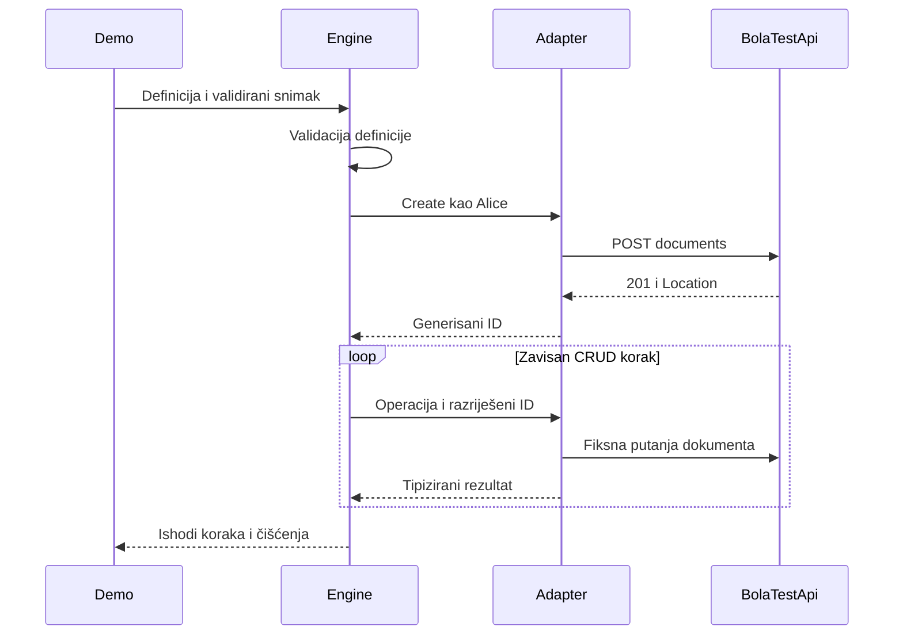

# Autorizovane sekvence lokalnih dokumenata

Faza 5.1 objedinjuje mape resursa i čišćenja opisane ovdje u registar po
izvršavanju i proširuje JSON rezultat.
[Trenutni model životnog ciklusa](implementation-v5-1-resource-lifecycle-modeling.md).

`DocumentSequence` opisuje nepromjenljivu, uređenu listu koraka za lokalni
CRUD. `DocumentStep` imenuje operaciju, logički resurs, direktne zavisnosti i
naslov kada ga operacija zahtijeva. Postojeći `TestScenario` zadržava ugovor
Read detekcije. Rezultati sekvence opisuju izvršavanje i čišćenje.

| Sloj | Odgovornost |
| --- | --- |
| Application | Definicije i rezultati, `DocumentSequenceValidator`, portovi `IDocumentSequenceExecutor` i `IOwnedDocumentClient` |
| Engine | Provjera zavisnosti, prijenos izlaza, poređenje pripremljenog stanja i čišćenje |
| Infrastructure | Fiksne lokalne rute, provjera odredišta, razrješavanje sintetičkog identiteta i priprema odgovora |
| Demo | Učitavanje postojećeg konfiguracionog formata, stvaranje snimka, opt-in definicija i JSON izlaz |



## Definicija i stanje izvršavanja

Validacija koristi postojeći ugovor koda, putanje i bezbjedne poruke.
Provjerava identifikator, naziv, identitet Alice, nepraznu sekvencu, operacije,
naslove, jedinstvenost koraka i proizvođača, redoslijed zavisnosti te
raspoloživost potrebnih izlaza. Svaki rad nad resursom direktno zavisi od
njegovog Create koraka. Verify dodatno zahtijeva jedan Read istog resursa i
provjerava vlasnika i naslov iz tog čitanja. VerifyAbsent očekuje HTTP 404
za identifikator istog resursa.

Izvršilac koristi isti validirani konfiguracioni snimak za svaki poziv
adaptera. Lokalni rječnici pamte ishod koraka, generisani ID, pripremljeno
stanje iz Read koraka i preostale obaveze čišćenja. Dvije sesije mogu
koristiti istu definiciju i logička imena. Svaka razrješava vlastite ID-jeve
iz svojih POST odgovora. Adapter prihvata relativni Location s GUID-om iz
fiksne CRUD kolekcije. Izvještaj sadrži sintetičke identifikatore, ishode
i dijagnostičke kodove.

## Greške, otkazivanje i čišćenje

Neuspješan preduslov preskače zavisne korake. Nezavisni koraci nastavljaju do
otkazivanja. Svaki Create implicitno zahtijeva čišćenje. Uspješan eksplicitni
Delete uklanja tu obavezu. Preostali potvrđeni resursi brišu se kao Alice u
obrnutom redoslijedu kreiranja, uz zajednički rok od pet sekundi i nezavisan
token. HTTP 404 pri čišćenju znači da resurs već odsustvuje. Svaki neuspjeh
ili istek roka bilježi se u strukturiranom rezultatu.

Poslani POST može dovršiti ograničeni zahtjev i nakon otkazivanja da bi
izvršilac mogao saznati ID za čišćenje. Ako API kreira dokument, ali se
odgovor izgubi ili izostane valjani Location, rezultat je `CreateUnconfirmed`.
Čišćenje takvog dokumenta zahtijeva podršku API-ja za korelaciju ili
idempotentno kreiranje. Ponovno pokretanje sintetičkog API-ja prazni memoriju.
Otkazivanje zavisi od toga da adapter poštuje rok zahtjeva i čišćenja.
CRUD podržava isključivo fiksni lokalni origin, Alice i privremene dokumente.
Priprema odgovora ograničava tijelo Read odgovora na 64 KiB.

## Pokretanje i testovi

Iz foldera `BolaDetector` pokreni API u prvom terminalu.

```powershell
dotnet run --project targets/BolaTestApi --no-launch-profile --urls http://127.0.0.1:5081
```

U drugom terminalu pokreni autorizovanu sekvencu.

```powershell
$env:ALICE_TEST_USER = 'alice'
dotnet run --project src/BolaDetector.Demo -- --document-sequence configs/demo-detection.json
```

Rezultat ide na standardni izlaz. Izlazni kodovi su `0` za uspjeh, `1` za
grešku i `130` za otkazivanje. Uobičajeni Demo argumenti i Read izvještaj
zadržavaju postojeći ugovor.

```powershell
dotnet build BolaDetector.sln -c Release
dotnet test BolaDetector.sln -c Release --no-build
dotnet format BolaDetector.sln --verify-no-changes --no-restore
```

Jedinični testovi provjeravaju semantiku i ugovore izvršioca. Integracioni
testovi koriste TestServer uz stvarni HTTP adapter. Procesni testovi
pokreću Demo i BolaTestApi, uz slobodan port 5081 za CLI regresije.

## Rezultati provjere

Release build s `-m:1` prošao je bez upozorenja i grešaka. Testovi s
`--no-build -m:1` prošli su u cijelosti, uz 96 jediničnih, 26 integracionih
i 5 procesnih testova. Provjera formatiranja je prošla.

Procesna Read regresija potvrdila je 8 scenarija, od kojih 6 ima ishod
`NoViolationObserved` i 2 ishod `ConfirmedViolation`. Procesna CRUD
sekvenca završila je izlaznim kodom 0, uz isti generisani ID u svih osam
koraka, oba uspješna poređenja stanja i HTTP 404 poslije brisanja.
Procesni fixture potvrdio je završetak pokrenutih procesa, a CLI sekvenca
ostavila je radni folder prazan.

Sljedeća faza upravljanja lokalnim resursima može uvesti korelaciju Create
zahtjeva i provjerljiv oporavak nakon izgubljenog odgovora. Stabilni
identifikatori koraka i eksplicitne zavisnosti opisuju redoslijed za
buduću analizu i minimizaciju autorizovanih sekvenci.
