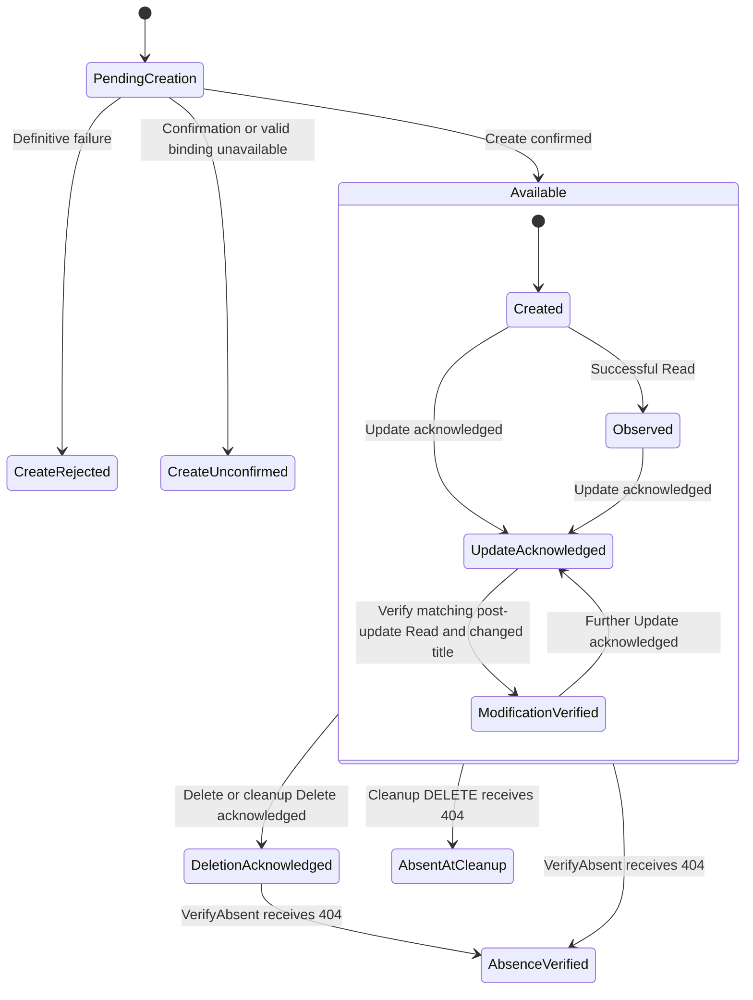

# Phase 5.1 — Resource lifecycle modeling

Phase 5.2 extends this model with owner-scoped creation recovery and
independent verification after compensating cleanup.
[Current recovery contract](implementation-v5-2-reliable-creation-and-cleanup.md).

A document sequence now returns an immutable lifecycle snapshot for one execution. The registry replaces the separate resource ID, observation, and pending cleanup maps. It registers each validated Create step before execution and associates the logical reference with an actual GUID only after confirmation. The execution ID identifies the run independently of its reusable sequence definition.

| Component | Responsibility |
| --- | --- |
| `DocumentResourceRegistry` | Owns bindings, transition rules, observations, history, and cleanup obligations for a single execution |
| `DocumentSequenceExecutor` | Coordinates prerequisites and cancellation, delegates authorized operations, and enforces the cleanup time budget |
| `DocumentLifecycleResult` | Exposes immutable tracked resources and ordered events through the additive `DocumentSequenceResult.Lifecycle` property |
| `LocalOwnedDocumentClient` | Prepares typed owner, organization, and title observations from bounded local responses |

Lifecycle decisions depend on the Application port and typed outcomes. They apply to the local document execution workflow. The Authorization Oracle continues to evaluate access using Domain rules. The Read configuration and detection report retain their existing contracts.

## Transitions



Attempt events leave the last confirmed state intact. A failed or skipped operation, a cancelled step, and an unsuccessful cleanup preserve that state. A failed absence check after successful Delete therefore leaves `DeletionAcknowledged`. Read, Update, Delete, and state Verify require an available binding. VerifyAbsent may check a bound ID again after acknowledged deletion or verified absence.

A successful Read records the observation. A successful state Verify continues to compare owner and title against its declared Read dependency. A modification transition also requires a Read after the latest acknowledged Update, the requested update title, and a different title from the last pre-update Read. A successful no-op Update or verification using an earlier Read remains distinguishable from independent proof of a change.

## Ownership and history

Each resource snapshot carries the expected owner ID, owner name and organization GUID from the validated Alice configuration. The adapter normalizes the local API label `org-a` to the canonical organization GUID in the demo configuration. The resource and Read events carry the latest and per-read observed values, respectively. Owner and organization comparisons have separate flags. A missing organization yields an unknown comparison. An unmapped label is preserved if safe and reports a mismatch. Organization diagnostics leave the established owner-and-title verification policy intact.

The history records a monotonic order, resource and step references, a GUID when known, action, event kind, previous and current states, outcome, and safe diagnostic reason. The containing lifecycle result identifies the execution. An attempt has an empty outcome until a result is recorded. The JSON result carries synthetic ownership metadata and identifiers. Titles are used in memory for verification. Raw responses and credentials stay out of the result.

## Confirmation and cleanup

Cleanup status is independent of lifecycle state. Confirmed creation requires cleanup. A successful explicit Delete clears the obligation, while a later VerifyAbsent can independently confirm absence. A cleanup DELETE that returns 404 clears the obligation and records `AbsentAtCleanup` unless the resource already has independently verified absence. A cleanup failure retains the last confirmed state and reports a failed obligation.

Compensating cleanup runs in reverse confirmed-creation order, within the existing total five-second budget and with Alice's configured identity. The registry supplies only IDs confirmed in that run. No extra cleanup call follows a successful explicit Delete.

If a dispatched Create loses its response or cannot provide a valid, unique binding, the final state is `CreateUnconfirmed`, the document ID is null, and the cleanup obligation is `UnresolvedCreation`. The existing `Cleanup` field reports compensating cleanup attempts and their outcomes. The sequence result's `Lifecycle.HasUnresolvedCleanup` also covers resources whose identity makes a cleanup attempt impossible. This distinction preserves existing consumers of `Cleanup` and keeps `Succeeded` false for unresolved work.

## Verification

The existing CLI command still runs the authorized sequence.

```powershell
dotnet run --project src/BolaDetector.Demo -c Release --no-build -- --document-sequence
```

NUnit coverage exercises registry behavior through the executor. Integration tests use the actual adapter and local TestServer, including a deliberately dropped successful Create response. The E2E sequence test starts its own API, runs the CLI twice, checks separate IDs and lifecycle results, then independently verifies 404 for both documents. The default-mode E2E test checks the original Read verdict counts. The existing architecture tests check compiled and project references.

The baseline run passed 96 unit, 26 integration, and 2 E2E cases. Three E2E cases hit an existing listener on port 5081, which also locked the Release apphost during the baseline build. After the listener stopped, the single-worker Release build completed with zero warnings and errors. The single-worker test run passed all 132 cases, including 100 unit, 27 integration, and 5 E2E. Formatting verification passed. The Read demo reported 8 scenarios with 6 `NoViolationObserved` and 2 `ConfirmedViolation`. Each authorized sequence run completed 8 steps, reported `AbsenceVerified`, and had no unresolved cleanup obligations.

Phase 5.2 should give each authorized Create a stable correlation key scoped to the execution and owner. The local API can then return the same committed identity for that key, allowing a bounded recovery path to confirm the exact resource before cleanup. This phase records uncertainty and leaves creation recovery for that subsequent contract.
