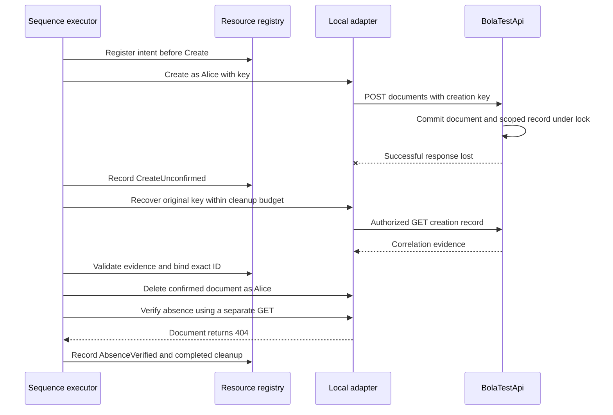

# Phase 5.2 — Reliable creation and cleanup

A committed Create can lose its response. The sequence registry now assigns an opaque creation GUID to every logical resource before dispatch. It retains the key with the execution, configured Alice identity, organization and normalized title. A lost or unusable Create response leaves the step failed, skips dependent work, and makes the intent eligible for bounded recovery.

## Local API contract

The optional `X-Creation-Key` header accepts one nonempty GUID in N format. The existing loopback synthetic-identity filter authenticates both Create and recovery. The store derives owner and organization on the server. Under one store lock it checks the scoped key and creates the document and record atomically. The record retains the original normalized title's SHA-256 digest and exact document ID.

| Request | Result |
| --- | --- |
| Create without a key | Existing 201 document representation |
| First scoped Create or equivalent repeat while the document exists | 201, original Location, and correlation evidence |
| Same scoped key with a different title | 409, including after deletion |
| Equivalent repeat after deletion | 410. The document stays deleted |
| Same key under another authenticated owner | An independent scope |
| Recovery of a committed key via GET /documents/creations/{key} | 200 with typed evidence, or 410 with tombstone evidence |
| No record within the authenticated scope | 204 with no document identifier |

Equivalent concurrent requests serialize under the same lock. Updating the document leaves the original Create intent intact. Records and tombstones live for the lifetime of the local API process. Process restarts discard records and documents. The key identifies an intent and access still requires authentication.

## Recovery and cleanup

Application's `ICorrelatedDocumentClient` extends the existing document port with explicit Create and recovery operations. Infrastructure owns the fixed loopback routes, headers, bounded JSON parsing, and wire-to-organization mapping. The Engine registry accepts evidence only for the same key and intended title, matching owner and organization, a valid GUID, and an ID unbound to another resource. History records recovery attempts, reasons, results, and the independently verified cleanup outcome. The original Create result stays failed even when recovery and cleanup succeed.

The finalizer shares one five-second budget for recovery, Delete, and verification. It looks up each uncertain intent at most once. A previously deleted record goes straight to absence verification. Successful explicit Delete avoids a repeated Delete, and the sequence's VerifyAbsent step or the finalizer must independently verify absence. Missing, unsupported, conflicting, invalid, or failed recovery leaves the cleanup obligation unresolved. A failed absence check retains any Delete acknowledgement and reports unresolved cleanup. Caller cancellation still stops normal steps. Cleanup and recovery use a separate bounded token.

## Tests and limits

The integration handler discards the successful response after the real test API commits Create. It checks that the same owner and key recover the committed ID and that Delete and independent GET target that ID. A separate case drops recovery and verifies that the document is retained with unresolved cleanup. Integration tests also cover concurrent equivalents, conflict, owner isolation, and deleted-key behavior. The process tests continue to run the standard CLI paths and check correlation in normal execution. The lost-response fault is injected at the integration transport boundary, where it can be deterministic without a runtime fault-injection feature.

The baseline passed 100 unit, 27 integration, and 2 E2E cases. An existing listener prevented 3 E2E cases from starting their own API and locked the Release output. After the listener was stopped, Release built with `-m:1` and zero warnings or errors, and the single-worker test run passed all 142 cases. The standard build failed without an MSBuild diagnostic and the standard solution test exited 1 without test output. The separate detailed E2E run passed 5, the separate architecture run passed 7, and formatting verification passed. Both normal authorized CLI runs finished with eight successful steps, independent absence verification, and no unresolved cleanup. The default Read CLI reproduced 6 `NoViolationObserved` and 2 `ConfirmedViolation` results.

The capability is specific to the controlled local target. Recovery is a single lookup, so a response that arrives before an in-flight creation commits can leave uncertainty unresolved. No replay, resource search, automatic Create retry, or durable recovery is used. A next phase could model explicit relationships among confirmed resources while retaining these cleanup eligibility rules.
