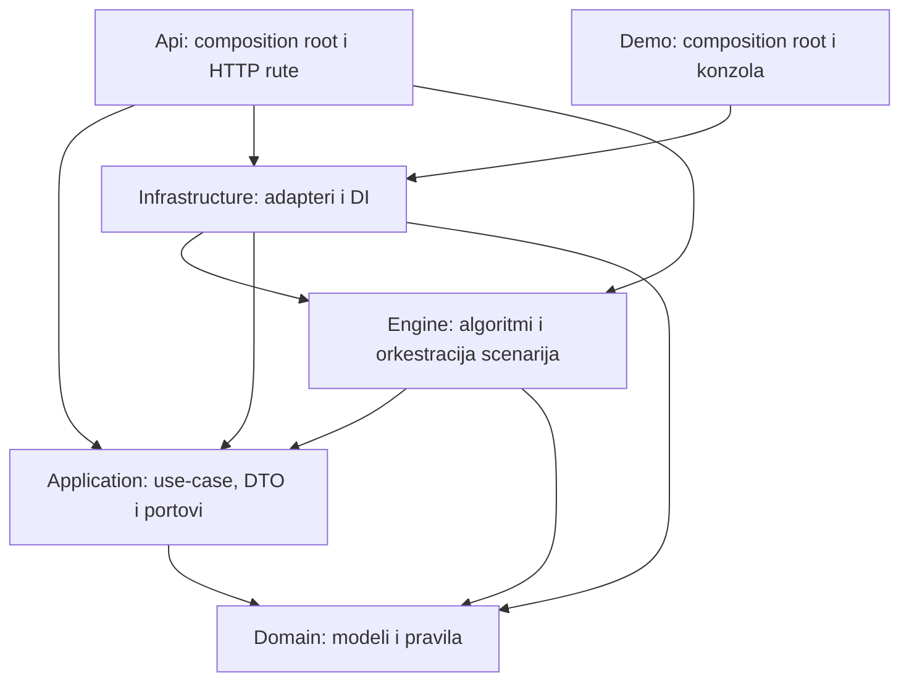

# SOLID i raspored projekta

Refaktorisanje prati prezentaciju **SOLID PRINCIPI.pdf**: slajdove 9–18 za SOLID, 20–23 za granice i composition root i 26–30 za procjenu promjena. Primjeri Logger–Blogger predstavljaju obrazac odgovornosti, a ne dodatne funkcionalnosti ovog projekta.

## Smjer zavisnosti

Domain nema reference na druge projekte. Application zavisi samo od Domain-a. Engine je dio poslovnog jezgra, izdvojen zbog detekcionog algoritma, i zavisi samo od Application/Domain. Infrastructure implementira portove i registruje konkretne algoritme Engine-a. Demo i Api su composition root-ovi. Testovi nisu dio produkcionog lanca.

Tok poziva od Engine-a ide ka HTTP adapteru, ali projektna zavisnost ide ka ugovoru `IScenarioRequestExecutor` u Application-u. Engine nema HttpClient, JSON, File/Directory, environment niti ASP.NET reference. Ovo je razlika između toka poziva i smjera zavisnosti sa slajda 22.

## Primjena principa

| Princip | Problem prije | Rješenje |
| --- | --- | --- |
| SRP | DetectionEngine je pripremao URL, slao HTTP, obrađivao greške, parsirao JSON, računao dokaz i klasifikovao rezultat. | Engine orkestrira; HttpScenarioRequestExecutor šalje zahtjeve; LocalTargetAddressPolicy provjerava adresu; JsonReadEvidenceVerifier provjerava sadržaj; FindingAnalyzer donosi domensku odluku. |
| OCP | Drugi transport ili format dokaza zahtijevao je promjenu centralnog engine-a. | Novi IScenarioRequestExecutor ili IReadEvidenceVerifier bira se kroz DI. Loader/writer imaju zasebne portove; nema switch-a po tipu adaptera u stabilnom toku. |
| LSP | Nisu bili jasno opisani ugovori kod grešaka i nedovoljnih dokaza. | Portovi obećavaju podržana čitanja: transportne greške su opažanja, otkazivanje se propagira, neprovjerljiv sadržaj ne potvrđuje nalaz. Testne zamjene poštuju isti ugovor. |
| ISP | Izvršavanje, mreža, tajne, konfiguracija i izvještavanje bili su spojeni. | Mali portovi prema ulozi: IScenarioGenerator, IScenarioRequestExecutor, IReadEvidenceVerifier, ITestCredentialProvider, IDetectionConfigurationLoader, IDetectionReportWriter i read-only IApiProjectReader. |
| DIP | Poslovni engine je poznavao HTTP i JSON detalje; API ruta je direktno čitala DbContext. | Poslovni tok koristi portove. Infrastructure implementira HTTP, env, JSON, OpenAPI i EF; ruta koristi IApiProjectReader. Konkretni tipovi biraju se na spoljašnjoj granici. |

Interfejs nije dodat svakom tipu. Stabilna pravila `AccessRule.Allows` i `FindingAnalyzer` ostaju u Domain-u. Fixture store je mali konkretni tip, a konzolni prikaz koristi standardni TextWriter. To prati upozorenje sa slajda 30 o pretjeranim apstrakcijama. Novi mutation tok treba zaseban ugovor; trenutni read adapter ne obećava operacije koje ne podržava.

## Odgovornosti i fajlovi

- **Domain**: Access, Projects, Resources, Scenarios, Findings. Jedan javni tip po fajlu; pravilo pristupa nalazi se uz AccessRule podatke.
- **Application**: Abstractions po ulozi, Models za konfiguraciju/izvršavanje/izvještaj, UseCases/RunDetection za kompletno izvršavanje. DTO-i nisu domenski entiteti.
- **Engine**: Authorization, Scenarios i Execution. Samo poslovno jezgro, bez NuGet i framework referenci.
- **Infrastructure**: odvojeni HTTP, env, JSON, OpenAPI, EF i datotečni adapteri. Registracije u DependencyInjection; migracije pripadaju Persistence/Migrations.
- **Api**: Program sastavlja host; Endpoints prevode HTTP zahtjeve u pozive portova.
- **Demo**: Program bira konkretne adaptere. DetectionConsoleApplication poziva use-case i writer; ConsoleReportPresenter formatira rezultat.
- **BolaTestApi**: Program sastavlja host, Documents sadrži fixture, Endpoints sadrži sigurnu i namjerno ranjivu rutu.
- **Web**: App.tsx prikazuje stranicu; main.tsx pokreće React. Nema novih frontend funkcionalnosti.
- **Tests**: unit testovi po odgovornosti, zajednički fixture saradnici, arhitektonski testovi i zasebni integracioni testovi detekcije/izvještavanja.

Postojeći Domain/Application/Engine namespace-i zadržani su gdje je moguće; tehnički tipovi sada pripadaju Infrastructure namespace-u. Folderi pokazuju odgovornost bez nepotrebnog širenja javnog namespace API-ja.

## Sačuvano ponašanje i migracija

Sačuvani su JSON format konfiguracije, komande, kategorije i format izvještaja. `IDetectionEngine.ExecuteAsync` ostaje isti. Promijenjen je konstruktor DetectionEngine-a, konfiguracioni/izvještajni DTO-i i TestExecution premješteni su u Application, a tehnički tipovi u Infrastructure; postojeći pozivaoci i testovi prilagođeni su tim granicama.

Ostaju ograničenje na 127.0.0.1:5081, isključeni redirect/proxy/cookies, timeout, ograničenje tijela i CancellationToken. Osam scenarija i dalje daje dvije potvrđene ranjivosti; status 200 bez dokaza ne postaje potvrđen nalaz.

## Validacija

- .NET build: 0 grešaka i 0 upozorenja.
- Testovi: 37 jediničnih i 2 integraciona, svi prolaze; EndToEndTests ostaje rezervisan.
- React/TypeScript build prolazi.
- Arhitektonski testovi čuvaju projektne reference i nezavisnost Domain/Application/Engine od frameworka.
- Testovi zamjene portova provjeravaju izvršavanje bez HTTP-a/JSON-a; test izvještaja provjerava zapis stvarnog JSON fajla.
- MySQL i Docker nisu dio ove provjere.

## Gdje ide naredna promjena

Drugi transport ide u novi adapter `IScenarioRequestExecutor`; novi dokaz u `IReadEvidenceVerifier`; drugi format konfiguracije/izvještaja u loader/writer. Pravilo vlasništva i organizacije mijenja se u Domain-u. Mutation scenariji zahtijevaju eksplicitne portove snimanja/resetovanja i testove stanja.

Za pregled budućih promjena koristiti pitanja sa slajda 27: razlog promjene, mjesto proširenja, poštovanje ugovora, veličina interfejsa i smjer zavisnosti. Struktura i testovi čuvaju sadašnje granice; nisu dokaz ispravnosti svakog budućeg proširenja.
